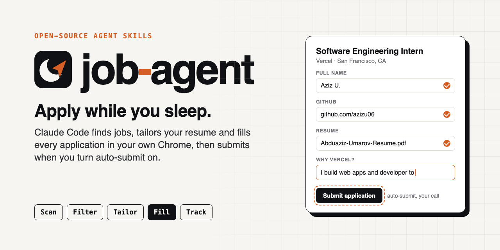
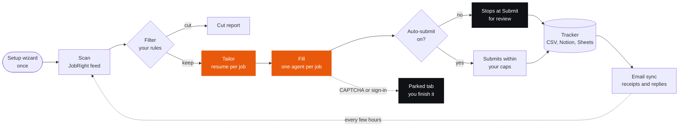

<h1 align="center">
  
  job-agent
</h1>

<p align="center"><b>Apply while you sleep.</b></p>

<p align="center">One line in your Mac's Terminal, with <a href="https://claude.com/claude-code">Claude Code</a> installed:</p>

```bash
claude plugin marketplace add azizu06/job-agent && claude plugin install job-agent@job-agent
```

<p align="center">
  <a href="LICENSE"></a>
  <a href="https://github.com/azizu06/job-agent/actions/workflows/ci.yml"></a>
  
</p>

<p align="center">
  <a href="#install">Install</a> ·
  <a href="#quickstart">Quickstart</a> ·
  <a href="#answers-in-your-voice">Answers in your voice</a> ·
  <a href="#safety">Safety</a> ·
  <a href="#troubleshooting">Troubleshooting</a> ·
  <a href="#faq">FAQ</a> ·
  <a href="#coming-next">Coming next</a>
</p>

<p align="center">
  
</p>

job-agent is a Claude Code plugin. It finds new postings, builds a one-page resume for each one from your master resume, writes the written answers in your own voice, and fills the application in your own Chrome. It never invents a fact. It submits for you when you turn auto-submit on, within daily and per-company caps; until then it stops at the final button so you can review each form first.

Built for Claude Code on macOS.

<p align="center">
  
  <br>
  <sub>A live run on Vercel's Greenhouse application, stopped at Submit. The applicant, Jordan Lee, is fictional.</sub>
</p>

## How it works



## You need

- [ ] A Mac
- [ ] [Claude Code](https://claude.com/claude-code)
- [ ] Google Chrome 144 or later (stable). Not Edge, Brave or Arc
- [ ] Node.js 20.19 or later
- [ ] Python 3.9 or later
- [ ] A free [JobRight](https://jobright.ai) account. Setup walks you through it
- [ ] A resume, any format. Setup turns it into a master resume
- [ ] Optional: `tectonic` and PyMuPDF (`pip install pymupdf`) to build the resume PDF and run its layout gate

New to some of these? [docs/getting-started.md](docs/getting-started.md) installs each one.

## Install

In your Mac's Terminal:

```bash
claude plugin marketplace add azizu06/job-agent && claude plugin install job-agent@job-agent
```

Or inside a Claude Code session:

```text
/plugin marketplace add azizu06/job-agent
/plugin install job-agent@job-agent
/reload-plugins
```

This also gives Claude the browser connection it needs.

Using another agent? The skills follow the open Agent Skills format, so `npx skills add azizu06/job-agent` loads them in Codex, Cursor and others, one job at a time; full support for them is on the [roadmap](#coming-next).

## Quickstart

1. **Install** with one of the commands above. In a running session, run `/reload-plugins` after.
2. **Turn on Chrome remote debugging.** Open `chrome://inspect/#remote-debugging` and switch it on. You do this once.
3. **Run setup:** `/job-agent:setup`. About 10 questions and 10 minutes. It writes nothing until you say yes.
4. **Try a dry run:** `/job-agent:run dry-run`. It scans, tailors and fills, and never presses Submit. When Chrome asks "Allow remote debugging?", click Allow.

When the dry run looks right, use `/job-agent:run`. To repeat it every 4 hours, use `/loop 4h /job-agent:run`.

## Pick a tracker

Every application gets a row: company, role, requisition ID, link, date, resume used, status and receipt.

| Tracker | You need | Pick it if |
| --- | --- | --- |
| **CSV** (default) | Nothing | You want it to work now. Opens in Excel, Numbers or Google Sheets |
| **Notion** | The Notion MCP connector | You already plan in Notion. Setup can create the database |
| **Google Sheets** | A Google Sheets MCP connector | You want a live sheet you can share or open on your phone |

Add the Gmail MCP to any of them and the agent finds receipt emails, then moves rows to Assessment, Interview, Offer or Rejected as replies arrive.

## What runs on its own

| You do once | It does every run | You still do sometimes |
| --- | --- | --- |
| Install the plugin or skills | Reads new postings in your JobRight feed | Clear parked tabs: CAPTCHAs, new sign-ins, codes |
| Turn on Chrome remote debugging | Filters them by title, term, pay, location and age | Answer missing-keyword questions, once per term |
| Mac only, for walk-away runs: grant Accessibility to the auto-allow helper | Builds a tailored resume for each job | Review filled forms, until you turn on auto-submit |
| Create a free JobRight account and sort it by Most Recent | Fills each form in its own tab | Keep the computer on and awake during runs |
| Give it your resume | Records every job in your tracker | |
| Answer the setup wizard | Finds receipts and status emails | |
| Sign in to optional connectors: Gmail, Notion, Sheets | Notifies you when a tab needs you | |

## Answers in your voice

Every written answer ("Why this company?", "Tell us about a project") goes through the `your-voice` skill before it is typed:

1. **Facts only, two angles.** It drafts from your master resume, standing answers and the job description, nothing else. It writes two drafts from different angles and keeps the more specific one.
2. **A built-in humanizing layer, always on.** It strips the common giveaways of AI writing (filler openers, "not just X but Y", stock words like "leverage", dashes) and applies plain craft moves: answer first, one idea, specific nouns, varied sentences.
3. **Your voice, if you want it.** Setup asks: "Want answers to sound like you? Paste 2-5 things you've written, or add your own writing rules. Skip to use the humanizing layer only." From your samples it learns your sentence length, openers and the words you use and avoid.
4. **Checks.** It audits itself (what still reads as AI, which fact you could not defend in an interview), then `writecheck.py` catches dashes, curly quotes, hidden Unicode characters and the form's length limit.

When you edit an answer, it saves the change as a rule in your voice profile, so the next answer starts closer to how you write. Answers you approve are kept as examples, never copied word for word. Nothing is sent to a second model or a paraphrasing website. Your samples stay in `~/.job-agent/voice/` on your computer.

## Safety

The agent never solves a CAPTCHA, never enters an SSN or payment details, and never touches a tab it did not open. It does not automate LinkedIn or any social site. When it hits a step only you can do, it parks the job: the tab stays open and filled, the tracker row says `Needs you: <reason>`, you get a notification, and the run moves on.

**Auto-submit is off by default.** Turn it on only after you trust the fills on your portals. Even then it stops at CAPTCHAs, sign-in walls, unanswered required questions and postings with a rule about AI tools, and it keeps to a daily cap and a per-company cap. A wrong answer sent with your name on it cannot be taken back.

**Terms of service.** Automating a website may break its terms, and a site may limit or close your account. The agent reads slowly in your own browser and uses no private APIs, which lowers the load but does not make automation allowed. You are responsible for how you use it.

**Employer AI policies.** Some employers ask applicants not to use AI tools. The agent reads each full posting for that language, fills those forms as usual, flags them in its report and its ready notification, and never auto-submits them, so you decide. Set `genai_restriction: skip` to skip them instead. Read each posting before you submit.

Full rules: [docs/how-it-works.md](docs/how-it-works.md#safety-rules).

## Troubleshooting

| Problem | Fix |
| --- | --- |
| Chrome never shows "Allow remote debugging?" | Check Chrome is 144 or later and open. Turn the switch on at `chrome://inspect/#remote-debugging`, then restart Chrome |
| The agent opened a new, empty Chrome | The browser MCP is missing `--autoConnect`. Run setup again, or copy the line from [docs/how-it-works.md](docs/how-it-works.md#browser) |
| "Allow" pops up for every job | Expected. Each job opens its own connection. Click Allow, or turn on auto-allow on a Mac |
| Resume upload fails with "not within any of the configured workspace roots" | You set a custom `JOB_AGENT_HOME`. The agent copies the PDF to a temp folder and retries. If it still fails, set `--workspace=` to your folder |
| Scan says "checkpoint not found" or reads old jobs | Your JobRight feed is not sorted by Most Recent. Sort it, then ask your agent to "recapture my JobRight feed" |
| Jobs run one at a time | The `job-applier` subagent is missing. Run setup again; it copies the file to `~/.claude/agents/` |
| A scheduled run stops at the first prompt | Headless runs need tools pre-approved. Copy the allow-list from [skills/job-run/SKILL.md](skills/job-run/SKILL.md) |
| Auto-allow clicks nothing | Grant Accessibility to the Python path that `enable` printed, and set Chrome's language to English |
| No resume PDF, only a `.md` or `.tex` file | Install `tectonic` and PyMuPDF (`pip install pymupdf`). Without them the agent hands you the source file and cannot run the layout gate |
| A form shows "needs corrections" after filling | The portal ignored a field. The agent re-reads every field before it calls a form ready; if it flags one, fix it by hand |
| Most jobs park as `Needs you: sign-in` | Sign in to Google in that Chrome, and keep Sign in with Google allowed in setup. Workday needs one account per company |

More in [docs/getting-started.md](docs/getting-started.md#if-something-goes-wrong).

## FAQ

<details>
<summary><b>What is JobRight?</b></summary>

[JobRight](https://jobright.ai) is a job board that builds a feed of postings matched to your profile. job-agent reads that feed in your own signed-in Chrome, newest first, and stops at the last job it saw. A free account is enough. If you do not want JobRight, the agent can use the Indeed MCP connector instead.
</details>

<details>
<summary><b>Is it free?</b></summary>

job-agent is free and MIT licensed. JobRight's free account works. The cost is your coding agent: a Claude, ChatGPT or Cursor subscription, or API usage. See the next question.
</details>

<details>
<summary><b>What does it cost in tokens?</b></summary>

Each job runs in its own agent session that reads the page, tailors a resume and fills the form, so cost scales with how many jobs you run and how long each form is. On a Claude Pro or Max plan it counts toward your plan's usage limit, not a separate bill. To see your real number, do a dry run on a few jobs and check your usage before you schedule it.
</details>

<details>
<summary><b>Does it work on Windows? Linux?</b></summary>

job-agent is built for Claude Code on macOS, and CI runs the test suite on macOS and Ubuntu. Windows and Linux are next on the [roadmap](#coming-next). The auto-allow helper for walk-away runs and reading SMS codes use macOS features.
</details>

<details>
<summary><b>Will I get banned?</b></summary>

It can happen. Automation may break a site's terms, and a site may limit or close your account. The agent lowers the risk: it works in your normal Chrome, reads slowly, uses no private APIs, never touches LinkedIn, never solves CAPTCHAs, and caps how many roles it applies to per company. Many companies also limit how many roles you can apply to, so the caps protect your candidacy too.
</details>

<details>
<summary><b>Can it apply through LinkedIn Easy Apply?</b></summary>

No. It does not automate LinkedIn or any social site. It applies on the employer's own portal (Greenhouse, Workday, Lever, Ashby and others). It can use the "Sign in with LinkedIn" button on a portal, if you allow it, but it never browses linkedin.com.
</details>

<details>
<summary><b>What if I have no resume?</b></summary>

Setup can start one with you from the [master resume template](skills/job-setup/assets/master-resume.md). You list your school, jobs, projects and skills, and the agent shapes them into entries. Every number and tool must be something you really did; the agent never adds facts of its own.
</details>

<details>
<summary><b>Will it lie on my resume or answers?</b></summary>

No. It only rewords and selects from your master resume and your standing answers. A checker fails any tailored resume that contains a number not found in the master, and a layout gate checks the rendered PDF (one full page, every line filled, even spacing) before it is uploaded. Written answers are drafted from the same sources by the `your-voice` skill, and any sentence it had to infer is listed for you to check. Set `written_answers: leave` to write them yourself.
</details>

<details>
<summary><b>Will my answers sound like ChatGPT wrote them?</b></summary>

That is what the `your-voice` skill is for. Each answer goes through a built-in humanizing layer that removes common AI giveaways, then, if you gave samples or rules, a rewrite in your voice, then a character and length check. It learns from every edit you make. It still only uses facts from your resume, so read each answer before you submit, and set `written_answers: leave` if you would rather write them yourself. See [Answers in your voice](#answers-in-your-voice).
</details>

<details>
<summary><b>Does it submit on its own?</b></summary>

Not unless you turn on `auto_submit`. Auto-submit when you turn it on: it presses the final button itself, within your daily and per-company caps, and still stops at CAPTCHAs, sign-in walls and unanswered required questions. It is off by default, so a first run fills everything, stops at the final button for your review, and the tracker row says `Ready`.
</details>

<details>
<summary><b>What happens at a CAPTCHA or a sign-in page?</b></summary>

It tries Sign in with Google, Microsoft or LinkedIn with an account already in your Chrome, then a login Chrome already saved. If none works, or it sees a CAPTCHA, it parks the job: the tab stays open and filled, and you get a notification. At the end of the run you get one list of parked tabs to clear in one sitting.
</details>

<details>
<summary><b>Where does my data go?</b></summary>

Your profile, resumes, tracker and run logs live in `~/.job-agent/` on your computer. Passwords, if you turn on the optional credential mode, live only in your OS keychain. Nothing personal goes into this repo. Your agent's model provider sees what the agent reads, as with any agent task.
</details>

<details>
<summary><b>Does my computer have to stay on?</b></summary>

Yes. The agent drives the Chrome on your computer, so runs need it on, awake and signed in. A cloud agent cannot reach your Chrome. On a Mac, walk-away runs also need the auto-allow helper.
</details>

<details>
<summary><b>Does it only do internships?</b></summary>

No. Set `seniority` to internship, new-grad, junior, mid or senior, set your pay floor per hour or per year, and list the titles you want. The examples use internships because the author is a student.
</details>

<details>
<summary><b>Can I stop or undo it?</b></summary>

Stop your agent at any time; filled tabs stay open. A submitted application cannot be pulled back by the agent, which is why auto-submit is off by default. To turn helpers off, ask your agent "turn off auto-allow".
</details>

<details>
<summary><b>Which coding agents does it work with?</b></summary>

Claude Code, including parallel appliers, one per job. Codex, Cursor and other agents that read skills can load them too and run one job at a time; first-class support for them is on the [roadmap](#coming-next).
</details>

## Coming next

- Codex and other agents, with parallel appliers
- Windows
- Linux

Want one sooner? Open an issue and say which.

More detail: [docs/how-it-works.md](docs/how-it-works.md). Development: [tests/e2e/README.md](tests/e2e/README.md).

---

<p align="center">
  <b>If job-agent saves you an evening of copy-pasting, star the repo.</b><br>
  It helps other students find it. Issues and pull requests are welcome.
  <br><br>
  <a href="https://github.com/azizu06/job-agent"></a>
  <br><br>
  <sub>MIT. By Aziz Umarov (<a href="https://github.com/azizu06">@azizu06</a>).</sub>
</p>
