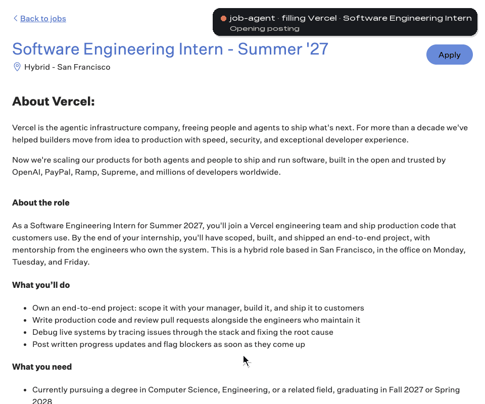

<h1 align="center">
  
  job-agent
</h1>

<p align="center"><b>Apply while you sleep.</b></p>

<p align="center">A Claude Code plugin that finds new jobs, tailors your resume for each one and fills the application in your own Chrome.</p>

<p align="center">
  <a href="LICENSE"></a>
  <a href="https://github.com/azizu06/job-agent/actions/workflows/ci.yml"></a>
  
</p>

<p align="center">
  <a href="assets/demo.mp4"></a>
  <br>
  <sub>A live run on a real posting, stopped at Submit. The applicant, Jordan Lee, is fictional. <a href="assets/demo.mp4">Watch the full video</a>.</sub>
</p>

<p align="center">
  <a href="#setup">Setup</a> ·
  <a href="#usage">Usage</a> ·
  <a href="#how-it-works">How it works</a> ·
  <a href="docs/faq.md">FAQ</a> ·
  <a href="docs/how-it-works.md">Docs</a>
</p>

job-agent reads new postings from your JobRight feed, builds a one-page resume for each role from your master resume, drafts the written answers from your own facts, and fills the form on Greenhouse, Ashby, Lever, Workday and other employer portals. It works in the Chrome you already use, with the logins you already have. It never invents a fact.

## Setup

You need a Mac, [Claude Code](https://claude.com/claude-code), Google Chrome 144 or later, Node.js 20.19 or later and Python 3.9 or later. New to any of these? [Getting started](docs/getting-started.md) installs each one.

1. **Install the plugin** from your Mac's Terminal. This also gives Claude the browser connection it needs.

   ```bash
   claude plugin marketplace add azizu06/job-agent && claude plugin install job-agent@job-agent
   ```

2. **Turn on Chrome remote debugging.** Open `chrome://inspect/#remote-debugging` and switch it on. You do this once.

3. **Run setup** in Claude Code:

   ```text
   /job-agent:setup
   ```

   It takes about 10 minutes. It asks about the roles you want, your standard answers, your resume (any format), your tracker and your free [JobRight](https://jobright.ai) account. It writes nothing until you say yes.

> **It stops at Submit.** job-agent fills each form and leaves the final click to you, unless you turn on `auto_submit`, and then only within your daily and per-company caps. CAPTCHAs, passwords and account creation are left to you: the agent parks that tab, filled and open, and notifies you.

Optional: install `tectonic` and PyMuPDF (`pip install pymupdf`) so the agent can build the resume PDF and check its layout. Without them you get the resume source file to export yourself.

## Usage

Start with a dry run. It scans, tailors and fills, and never presses Submit:

```text
/job-agent:run dry-run
```

When Chrome asks "Allow remote debugging?", click Allow. Read a few filled forms. When they look right, run it for real, or repeat it every 4 hours while the session is open:

```text
/job-agent:run
/loop 4h /job-agent:run
```

Each run ends with a summary: forms ready for your review, written answers to check, and parked tabs to clear in one sitting. Every application gets a row in your tracker: a local CSV by default, or [Notion or Google Sheets](docs/how-it-works.md#trackers). Add the Gmail connector and rows move to Assessment, Interview, Offer or Rejected as replies arrive.

## How it works


- **Scan** reads your JobRight feed, newest first, down to the last job it saw.
- **Filter** cuts jobs by title, term, pay floor, location and age, and skips roles you already applied to.
- **Tailor** builds each resume only from your master resume and asks you about keywords you lack. A checker fails any copy with a number that is not in the master.
- **Fill** runs one agent per job, each in its own tab, with real clicks and typing. It re-reads every field before it calls a form ready.
- **Answers** come from your resume and standing answers only, pass through a humanizing layer, and can match your own voice. See [Answers in your voice](docs/your-voice.md).
- **Track** records every job and finds the receipt emails.

Your profile, resumes, tracker and logs stay in `~/.job-agent/` on your computer. Full detail: [docs/how-it-works.md](docs/how-it-works.md).

## Limits

- Built for Claude Code on macOS. Your computer has to stay on, awake and signed in during runs, because the agent drives your local Chrome.
- Needs Chrome itself on the stable channel. Edge, Brave and Arc do not have the setting it uses.
- Chrome asks "Allow remote debugging?" for each new agent connection. An optional macOS helper clicks it for walk-away runs.
- It never solves a CAPTCHA, never enters an SSN or payment details, never touches a tab it did not open, and never automates LinkedIn or other social sites.
- Postings that ask applicants not to use AI tools are flagged and never auto-submitted. Set `genai_restriction: skip` to skip them.
- Automating a website may break its terms, and you are responsible for how you use it. See the [safety rules](docs/how-it-works.md#safety-rules).

Stuck? [Troubleshooting](docs/troubleshooting.md) · [FAQ](docs/faq.md)

## Roadmap

Codex, Cursor and other agents with parallel appliers, then Windows and Linux. Want one sooner? Open an issue and say which.

---

<p align="center">
  <b>If job-agent saves you an evening of copy-pasting, star the repo.</b><br>
  It helps other job seekers find it. Issues and pull requests are welcome.
  <br><br>
  <sub>MIT licensed. Made by <a href="https://github.com/azizu06">@azizu06</a>. Development: <a href="tests/e2e/README.md">tests/e2e/README.md</a>.</sub>
</p>
